# 稿流图文技术方案

从产品资料到平台草稿，下面通过架构图、流程图与工作台界面展示系统如何协作。图中蓝色表示界面，紫色表示 AI 处理，青色表示服务，金色表示存储，玫红色表示校验与确认，绿色表示输出。每张图使用独立 classDef 配色，可直接在支持 Mermaid 的 Markdown 阅读器中渲染。

## 1. 项目概述与产品定位

稿流面向独立开发者、产品运营和小团队，解决产品资料零散、推广表达缺乏结构、AI 内容难以追溯以及多平台草稿整理繁琐的问题。用户从产品事实、目标读者和推广目标出发，完成资料整理、结构规划、推文生成、审阅核验、视觉配图、版本保存和草稿同步。

平台支持产品发布、功能更新、开源推广等图文场景。用户可围绕同一份产品资料组织宣传内容，在工作台中编辑、配图和保存版本。界面和数据库以 article/文章作为稿件对象。

项目基于团队自有 open-publisher 蓝本迁移，以 Python/FastAPI、React/TypeScript、MySQL 和 Redis 实现浏览器访问、多用户归属和后端秘密管理。

### 从产品资料到平台草稿

主线围绕一份稿件展开，资料、正文、配图和历史版本在同一工作台衔接。

## 2. 需求分析与核心场景

| 使用者 | 任务 | 交付结果 |
|---|---|---|
| 独立开发者 | 把 README 和功能事实转为产品上线推文 | 有目标读者、事实依据和行动入口的稿件 |
| 产品运营 | 按已有模板准备功能更新内容 | 可编辑正文、素材、平台草稿 |
| 小团队内容负责人 | 检查风险、比较修改、恢复历史 | 保留版本与人工确认记录的创作过程 |

功能需求包括结构化创作输入、分阶段 AI 执行、流式反馈、Markdown 编辑预览、AI 修改、历史版本、模板和素材管理、智能配图以及同步草稿。非功能需求包括内容隔离、并发冲突检测、失败保留、可取消任务、敏感数据保护和可复现部署。

匿名用户可浏览公共示例，编辑和另存本机内容；设置和 AI 动作按需登录。取消登录保留输入，登录成功后由用户再次确认操作。本机编辑保存在当前浏览器，账号内容由后端按用户归属管理。

### 公共体验与按需登录

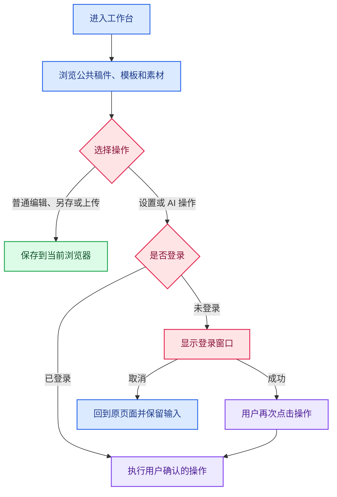

公共体验直接进入工作台；登录取消后保留输入，登录成功后由用户再次确认 AI 操作。

## 3. 系统架构

React 用户端和独立管理端通过 HTTP API 与 FastAPI 通信。后端负责鉴权、业务校验、模型访问、版本提交和运行事件；MySQL 保存业务实体、用量账本、管理员操作审计及密钥审计，Redis 提供推文工作流的状态与事件支持。Writer 通过 MySQL 中的 RunJournal 保存运行事件，并提供 SSE 续读。管理员在独立运营工作区管理成员与管理员账号、检查用量及估算成本、配置模型单价并查看安全审计；模型配置位于单独的管理分区。

Web 工作台通过浏览器扩展将稿件同步到平台草稿箱，由用户在目标平台确认发布。后端 Outbox 提供独立的发布计划、审批、幂等入队和回执处理接口，支持 dry-run 调试。

### 系统组件与数据流

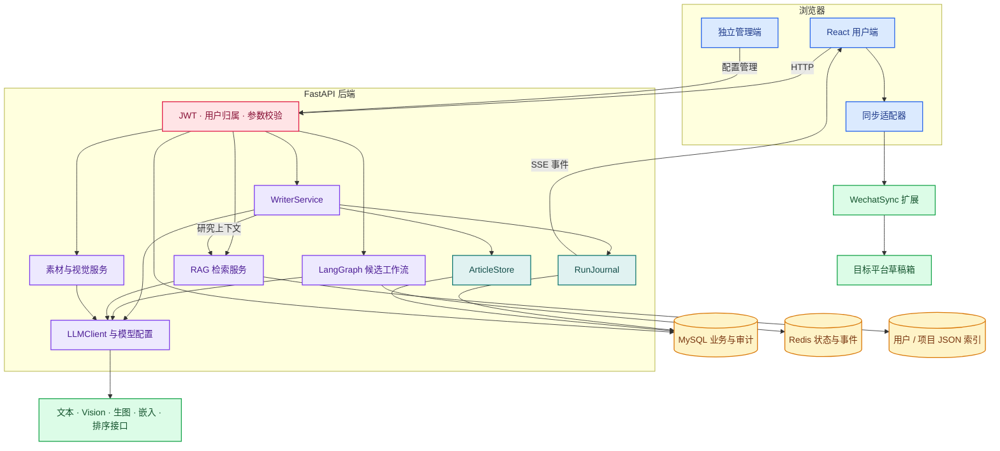

Writer 的运行日志与稿件修订保存在 MySQL；LangGraph 候选链路使用自己的运行状态与事件支持。浏览器草稿同步经扩展连接目标平台。

## 4. AI 选型、集成与优化

采用 OpenAI 兼容 HTTP 接口降低模型供应商绑定，文本、生图、嵌入和排序配置分别管理。每个创作节点可以绑定独立文本模型，用户可按质量、能力与成本作选择。需要图片理解时校验 Vision 能力；生图请求使用独立模型配置。

LLMClient 支持流式文本、Function Calling、结构化 JSON、模型能力与参数兼容处理。Writer 注册 write_article、github_repository 和满足配置条件的 web_search 等工具，模型先读取资料再提交正文。工具参数经过结构校验；只有成功调用写入工具并提交版本，系统才将内容视为已保存。网页、资料和工具返回均视为不可信内容，不作为系统指令执行。

工具循环设有迭代上限；单轮模式附带输出约束和工具标记清洗。运行事件向界面反馈停止、超时、上游错误和截断状态，保留上下文供用户继续处理。风险、审阅和事实核验结果通过 Pydantic 契约校验，再展示检查状态与具体问题。

模型读取超时和正文生成总时限分开控制，默认正文总时限为 900 秒。流式生成阶段呈现进度。正文增量批量落库并经缓冲呈现，避免每个 token 都生成数据库事务或触发大量页面刷新。

源码证据：backend/app/agents/llm_client.py、services/writer_service.py、schemas/writer_results.py、services/writer_stream.py。

### 模型调用与工具写回

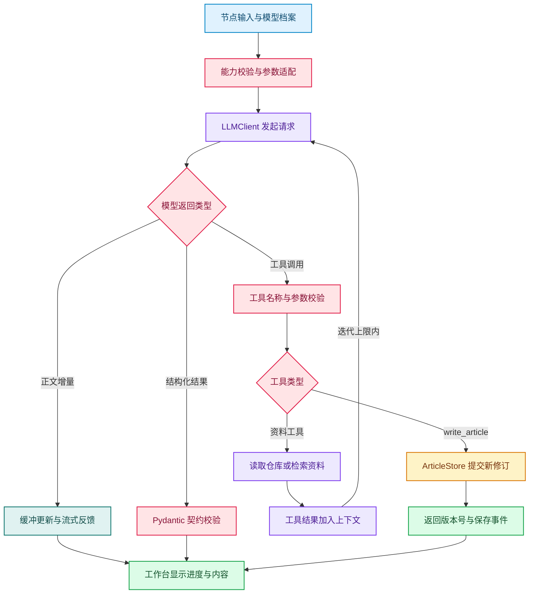

流式内容用于反馈；稿件保存以工具调用成功并提交修订为准。

## 5. 两条工作流与可观测性

工作台由 WriterService 编排 research、outline、draft、natural-style、review、reference-safety、risk、visual 八个阶段。各节点可关闭或切换模型；visual 阶段衔接前端配图方案，由用户确认素材和位置后应用图片。

| 阶段 | 输入与处理 | 输出与落点 |
|---|---|---|
| 资料研究 | 用户资料、可用检索与 RAG 上下文 | 有来源的上下文、研究事件 |
| 大纲与正文 | 目标读者、语气、事实、大纲 | write_article 提交、ArticleRevision |
| 风格与审阅 | 已保存正文、审阅结构化结果 | 可选新版本、分数与具体问题 |
| 事实与风险 | 资料、当前修订 | 检查事件与 checkedRevisionId |
| 视觉方案 | 段落、素材、模型能力 | 用户确认后匹配/生成/插入 |

### Writer 分阶段创作

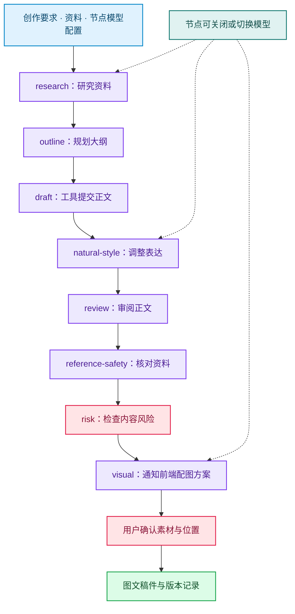

图示为启用各节点时的顺序。visual 阶段衔接前端配图，由用户确认后应用。

RunJournal 状态包括 pending、running、waiting_user、stopping 及终态；每个运行事件有序列号，可从指定序列续读 SSE。节点状态、工具结果和版本号形成可审查过程，跨路由保留任务状态。

### 运行事件与跨页续读

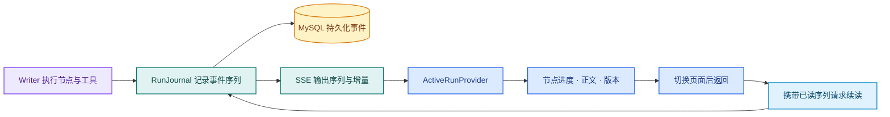

事件序列将后端执行与前端展示连接起来，返回页面后继续读取运行记录。

LangGraph 推文候选链路依次完成产品分析、受众分析、策略规划、候选生成、Critic 评分、Rewriter 改写、安全检查和格式化。评分未达阈值时进入改写分支，到达阈值或迭代上限后结束。WriterService 负责工作台分阶段创作，LangGraph 负责候选评分与循环改写，两者共享模型和存储服务。

### LangGraph 候选评分与循环改写

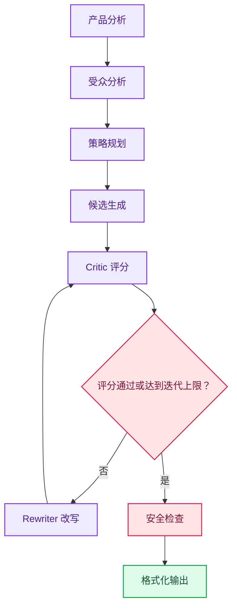

候选链路按评分结果选择改写或结束循环，与工作台 Writer 编排分别承担职责。

## 6. RAG 与事实证据

参考资料按 Markdown 标题感知分块，中文 bigram 分词配合 BM25；配置可用时计算嵌入、向量召回，通过 RRF 融合词法与向量结果，再按配置执行 reranker 重排。命中片段带来源编号注入写作上下文，后续事实核验对照资料检查断言。

资料库按用户命名空间隔离，项目索引同时检查项目归属。系统检测嵌入配置变化，维护索引与模型的一致性；检索服务异常时可切换到受限原文上下文，并记录处理方式。

索引采用 JSON 文件存储，通过进程内互斥和原子替换完成写入。测试覆盖分块、召回、融合、重排、来源编号和用户隔离。

实现见 backend/app/services/rag_service.py，相关测试包括 test_rag_service.py、test_retrieval_models.py 和 test_tenant_isolation.py。可沿输入资料、research 事件、命中编号与正文引用查看资料使用过程。

### RAG：从资料入库到正文引用

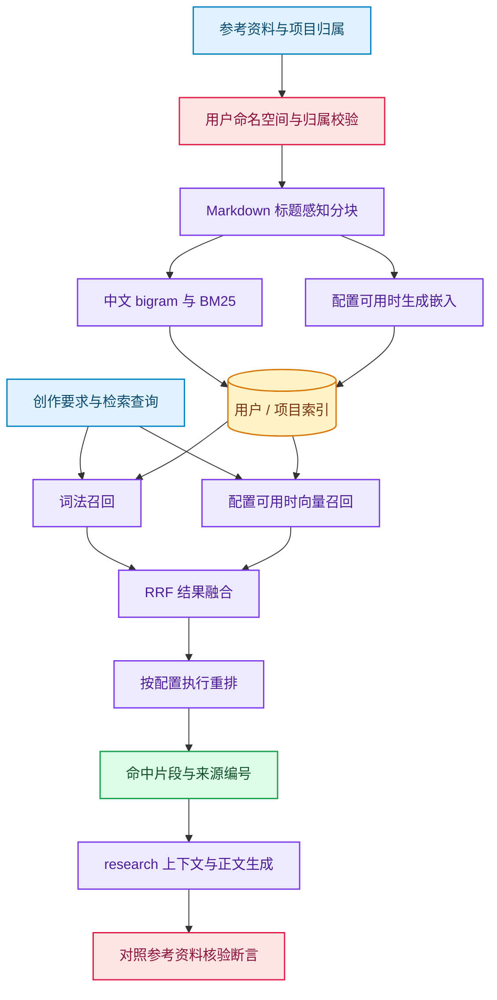

资料处理、检索融合和引用核验按阶段衔接，检索结果携带来源编号进入创作上下文。

## 7. 文本图像多模态与配图

支持图片作为创作或助手输入，能力适配后传入 Vision 模型；素材库提供上传、描述和图像分析，生图使用独立配置。视觉方案先规划图片职责和插入位置，再匹配可用素材，未命中时按用户确认调用生图模型。

正文用 asset:// 保存紧凑素材引用，渲染层解析图片。新上传素材可拖入编辑区或预览真实落点；已插入图片移动而非重复；配图确认、取消、重试与后台状态可被观察。AI 修改和配图落稿通过新修订保留历史。

文本生成、图片理解、素材匹配和配图落稿共同组成图文创作流程。

### 图像理解、素材匹配与配图落稿

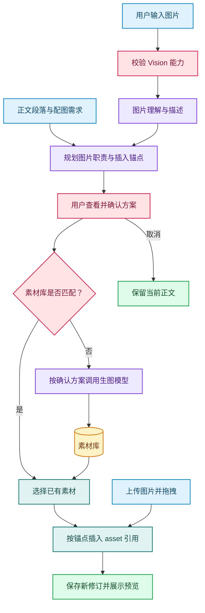

配图以正文位置为依据。用户确认方案后匹配或生成素材，也可上传图片并拖入正文。

## 8. 版本、安全与发布控制

ArticleStore 以 baseRevisionId 和 baseContentHash 实现乐观并发，冲突返回 409。每次有效修改写入不可变 ArticleRevision；恢复旧稿会产生新修订，保留历史链；标题和正文均未变化时不产生空版本。

### 修订保存与历史恢复

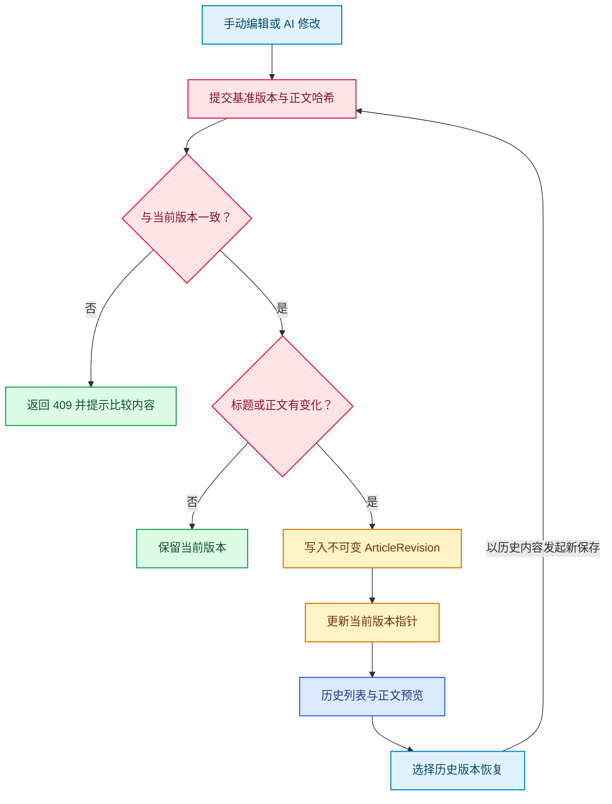

恢复历史会生成新修订，已有版本保持可追溯。

LLM、生图和集成 API Key 只以 Fernet 密文存入后端 app_secrets，主密钥 SECRET_ENCRYPTION_KEY 来自环境。没有 API Key 环境变量回退，不回显前端，不写入日志，配置变更有审计。JWT 和数据库凭据独立由环境配置。生产环境 APP_ENV=production 时拒绝占位 JWT、过短管理员密码和无效主密钥，在迁移/服务导入阶段即失败。

### 模型密钥的加密使用路径

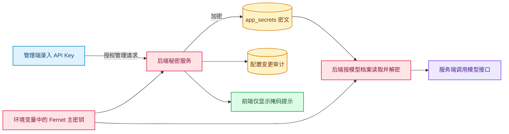

API Key 经后端加密后入库，模型请求由服务端发起，管理界面显示掩码提示。

同步前调用 sync-preflight，复用已有风险报告。报告绑定已保存版本；正文或版本变化时要求人工核验。高风险禁用同步，中风险与待确认状态由用户勾选确认。登录用户的确认记录写入 RunJournal，绑定用户、修订和正文哈希。

插件提交前复核风险状态，私人素材转换为图片字节后传给插件，并剥离网站登录令牌。界面防止重复提交，显示同步状态和草稿链接，用户在平台草稿箱确认最终发布。

### 草稿同步的风险确认流程

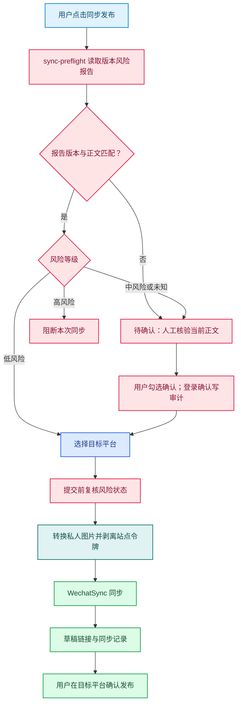

预检复用当前风险报告，不额外调用模型。同步目标是平台草稿箱。

后端 Outbox 提供审批哈希绑定、唯一幂等键、状态机、回执、结果核验与 dry-run 接口。

### 独立 Outbox 的审批与投递

Outbox 为独立后端接口路径，浏览器扩展同步使用上一张图中的流程。

## 9. 前端工程与交互

React/TypeScript 组件覆盖创作、编辑、助手、模板、素材和模型设置，路由使用 lazy/Suspense 与错误边界。SSE 与活跃运行上下文管理任务状态。登录前后复用同一工作台，取消登录保留输入，移动端支持导航与编辑。

独立管理端以运营工作区呈现用户目录、用量概览与明细、模型价格和安全审计，并将模型配置单独分区。账号管理包括按角色和状态筛选、排序、新建、启停用、改角色和重置密码；当前登录管理员不能停用自身或降为成员，后端也保护最后一个可用管理员。用量事件记录调用、Token、图片、状态、延迟及单价快照；未配置匹配价格时标记未计价，不推算虚构成本。

客户端和管理端使用自绘下拉控件呈现统一的触发器、选中态与圆角选项菜单。管理端菜单通过 portal 避免抽屉裁剪，并支持视口边缘定位、方向键、Home/End、Enter、Escape 和 Tab。客户端主题可跟随系统或手动切换，首页、登录页、工作台及跨标签页的主题状态保持同步。账号菜单提供账号切换入口。

页面按路由拆包，Mermaid 在正文或缩略图出现图表时动态导入。本地生产构建冷缓存测量中，创作首屏加载 5 个脚本，编码体积合计 98,102 bytes；三次 FCP 为 788ms、264ms、112ms，图表引擎请求为 0。测量环境为 Edge headless、本地 Vite preview、无网络节流，健康和设置 API 使用固定测试响应。

### 前端状态组织与按需加载

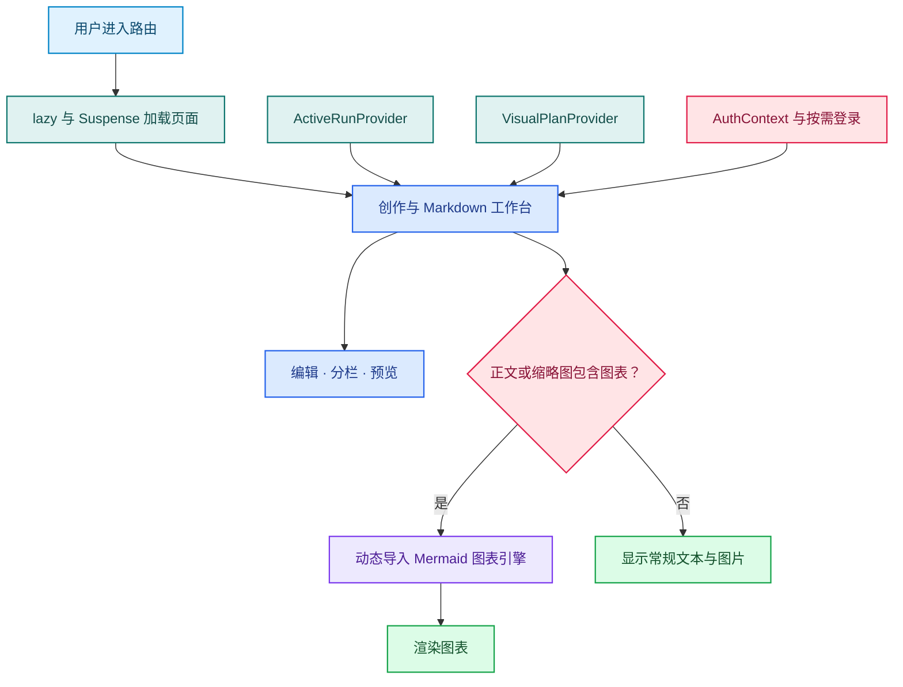

共享上下文保留运行与配图状态，图表引擎随内容需要加载。

## 10. 测试策略与可复现部署

后端 pytest 使用 SQLite 隔离库和模型替身，覆盖业务状态、权限、并发、版本、检索、模型配置、秘密管理和发布。双前端 build 包含类型检查；Playwright 覆盖关键页面、流式反馈、配图、模板、账户、公共示例和同步风险。

2026-10-31 后端回归共 334 项通过，用户端与管理端构建通过。11 个既有浏览器脚本及管理端专题 Playwright 检查覆盖主要操作；近期主题同步检查验证系统偏好、显式覆盖和跨标签页更新。测试命令与分项证据见验证记录，界面截图使用公共示例数据或隔离测试夹具。

Docker Compose 启动 MySQL、Redis、FastAPI 和双前端，首次启动自动执行 Alembic 迁移并创建管理员。数据库密码、JWT、管理员密码和 Fernet 主密钥通过环境配置；模型 Key 在管理端加密入库。Mock 服务提供固定响应、SSE 和 write_article 工具调用，可在独立测试环境复现接口交互。

### 本地部署拓扑与启动依赖

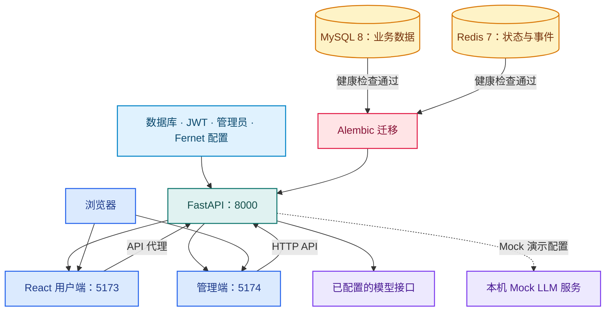

Compose 按数据库与 Redis 健康状态启动后端，迁移完成后提供 API，再启动双前端。

### 工程验证与评审材料

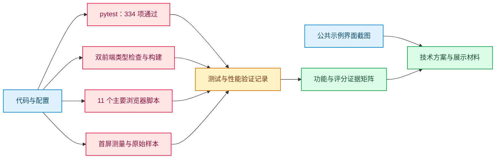

测试、构建、浏览器操作与性能样本分别提供证据，结果集中在验证记录中。

## 11. 应用价值与设计特点

产品推广文案需要把功能事实转成读者关心的信息。平台将资料、受众、策略与行动入口放入创作要求，供大纲、正文和审阅阶段共同使用。用户能查看节点状态、资料来源和生成版本，也能随时修改内容。任务跨页继续，改写保留历史，配图经确认后写回。

平台将资料整理、写作、审阅、配图和草稿同步放在同一工作台，减少小团队在不同工具间复制内容的操作。事实确认、版权审核和最终发布由用户掌握。模板、素材与版本记录可以复用。

文本、图片、嵌入和排序模型分别配置，节点可按任务选择模型。资料限额、取消和超时机制控制单次任务的调用范围；公共示例支持直接体验编辑、模板和素材。

## 12. 工作台界面

### 创作入口

填写目标读者、产品事实与创作要求，组织本次生成任务。

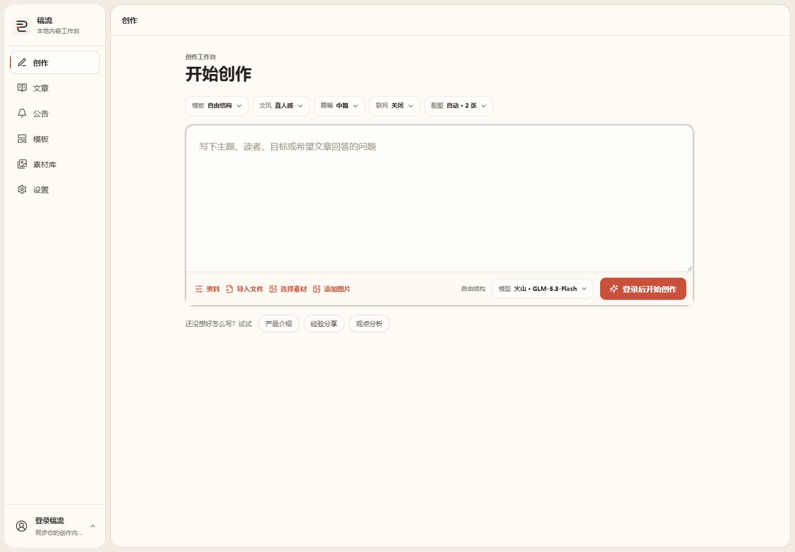

### 编辑与预览

在同一工作台完成 Markdown 编辑、预览、配图与版本操作。

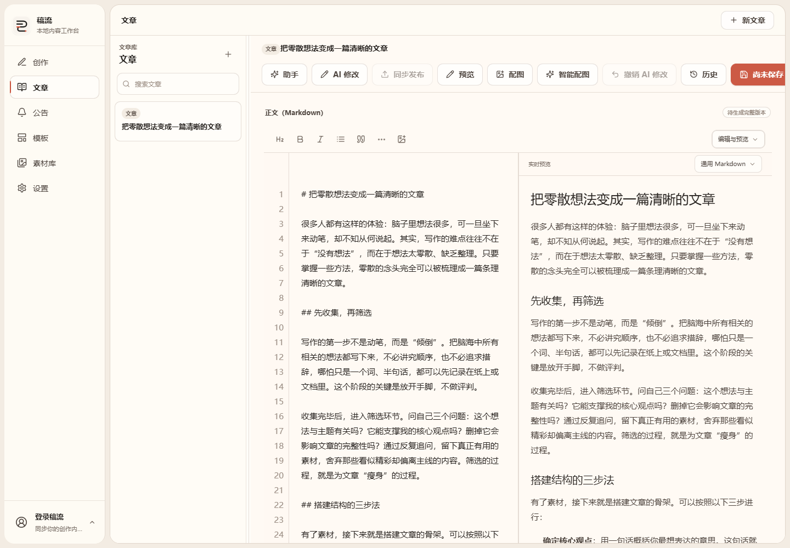

### 模板与素材

模板复用内容结构，素材库集中管理图文资源。

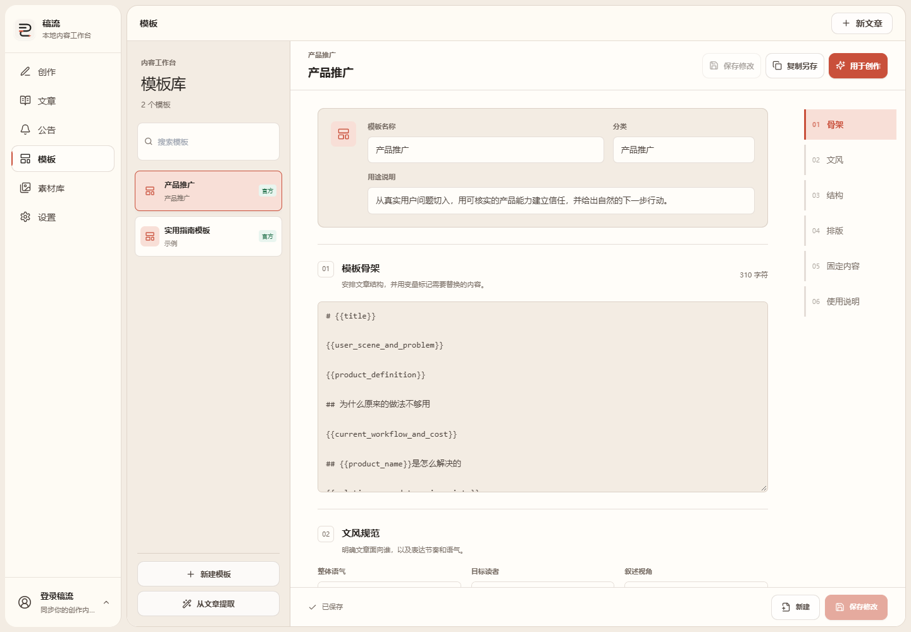

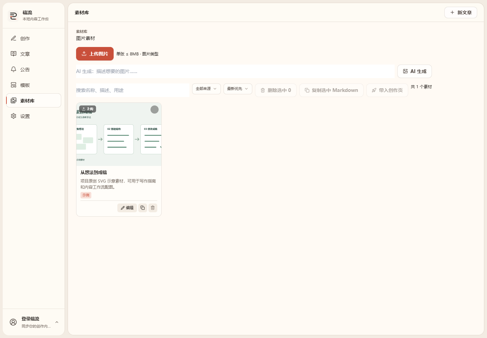

### 移动端

窄屏布局保留导航与模板编辑入口。

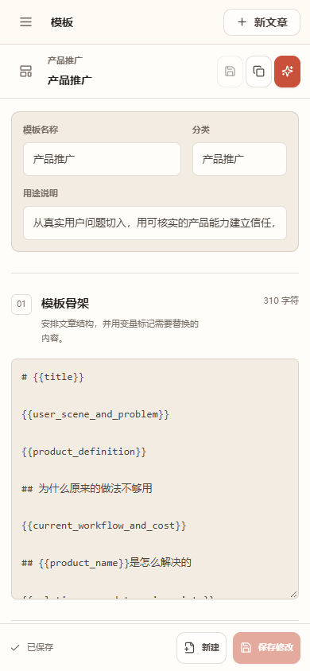
