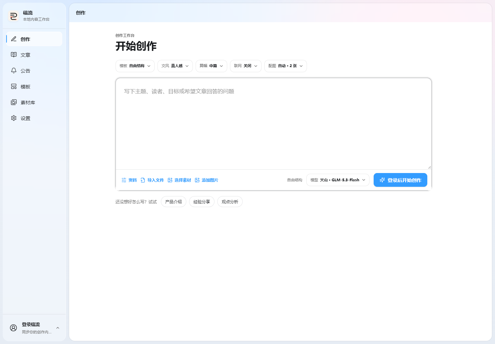
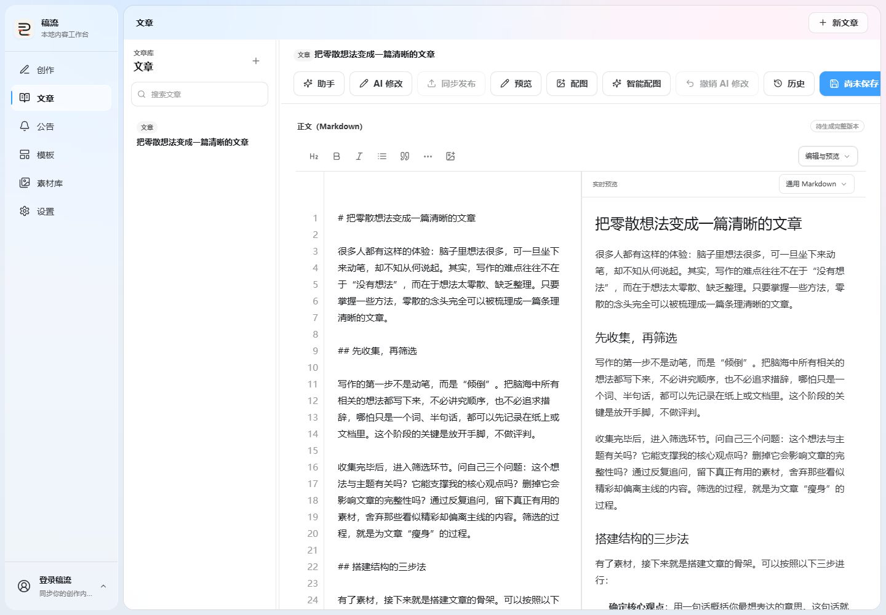
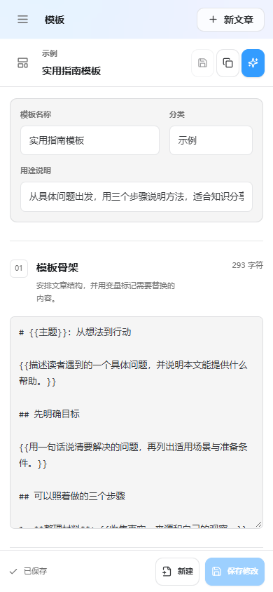

# 评委操作指南

## 1. 浏览公共示例

启动后访问用户端 http://localhost:5173。进入“文章”，打开公共示例《把零散想法变成一篇清晰的文章》，切换编辑、分栏与预览视图。修改后保存并查看本机版本。

进入“模板”，选择“复制另存”，修改并保存模板；进入“素材库”，查看示例图片或上传图片。匿名编辑、模板另存和上传内容保存在当前浏览器。

点击设置或 AI 操作后，登录窗口按需打开。取消或按 Escape 可回到原页面，输入内容保留。登录后再次点击操作按钮，即可继续。

## 2. 创作与编辑

| 操作 | 可观察的结果 |
|---|---|
| 输入产品事实、目标读者与创作要求，开始生成 | 按阶段显示研究、大纲、正文与审阅状态，正文流式更新 |
| 切换页面后返回工作台 | 继续查看当前运行状态与正文 |
| 使用 AI 修改并保存 | 生成新修订，历史版本可查看 |
| 恢复历史版本 | 以历史内容创建新的恢复修订 |
| 查看并确认配图方案 | 素材按确认的位置插入正文 |
| 上传图片并拖到编辑区或预览区 | 按落点插入图片，移动已有图片时保持单份 |
| 取消配图或拖拽操作 | 保留正文与待插入素材 |

## 3. 同步到平台草稿箱

在 Chrome 或 Edge 安装 WechatSync，允许扩展访问本站，刷新工作台并登录目标平台。在稿件页点击“同步发布”，查看预检结果后选择目标平台。

高风险稿件由应用阻断同步；中风险、待确认状态或正文变化时，需要核对内容并勾选确认。同步后可查看记录与草稿链接，在目标平台草稿箱确认最终发布。

## 4. Mock 演示环境

在独立的演示副本中配置 .env，填写数据库、JWT、管理员密码与 Fernet 主密钥。同机运行多个副本时，为各副本设置独立容器名和端口。执行：

~~~powershell
docker compose -f docker-compose.yml -f docker-compose.mock.yml up -d --build
~~~

访问管理端 http://localhost:5174，新建文本模型档案：接口 http://mock-llm:8001/v1，模型名 mock，演示 Key 为 mock-local-only；启用 tools 能力并设为演示默认模型。

登录用户端，选择该模型，关闭联网与生图节点，输入产品事实和推广要求。Mock 返回固定内容，支持 SSE 与 write_article 工具调用，可查看节点、正文与版本变化。
